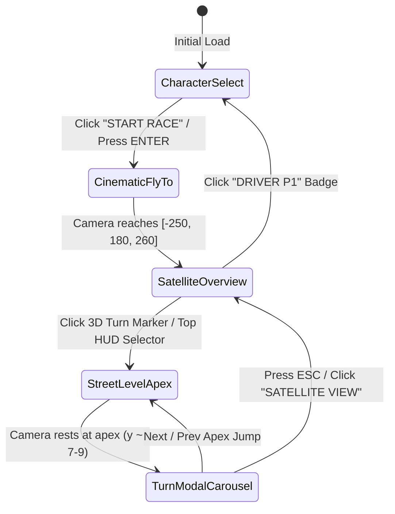

# Technical Implementation & Architecture

## 1. Overview & State Machine Flow

The application follows an asynchronous state machine managed globally via **Zustand** (`usePortfolioStore`):



### Core Store Actions (`src/store/usePortfolioStore.js`)
* `activeScreen`: `'character_select' | 'racing_track'`
* `selectedTurn`: `null | 1 | 4 | 10 | 12 | 14`
* `isCameraTransitioning`: `boolean` (locks input while camera moves)
* `currentSector`: Dynamically computed (`1` for Turns 1 & 4, `2` for Turn 10, `3` for Turns 12 & 14)
* `playSound(type)`: Procedurally generates audio via Web Audio API (`'rev'`, `'whoosh'`, `'click'`) with zero external audio assets.

---

## 2. Component Hierarchy

```text
src/
├── main.jsx                       # Application bootstrap (React 19 StrictMode)
├── App.jsx                        # Root coordinator, full-screen canvas & AnimatePresence
│   ├── components/canvas/
│   │   ├── TrackScene.jsx         # Canvas, lighting, fog, Environment preset="city"
│   │   ├── CircuitModel.jsx       # Loads barcelona.glb, double-click handler & 3D HTML markers
│   │   └── CameraRig.jsx          # CameraControls wrapper with smooth setLookAt animations
│   └── components/ui/
│       ├── CharacterSelectMenu.jsx # Full-screen anime fighter driver selection overlay
│       ├── HUDOverlay.jsx          # Top racing telemetry bar, speedo, sector indicator & turn jumps
│       └── TurnCarouselModal.jsx   # Glassmorphic modal carousel presenting career milestone cards
├── data/
│   └── resumeData.js              # Turn coordinates, telemetry metrics, and profile data
└── store/
    └── usePortfolioStore.js       # Global Zustand reactive store
```

---

## 3. WebGL & Performance Optimization Strategies

### A. 3D Model Optimization (`meshopt` & `KHR_mesh_quantization`)
* The raw 3D Barcelona circuit model was optimized from 93MB down to **38MB** using `meshopt` geometry compression and coordinate quantization.
* In Three.js, geometry memory allocation is minimized, avoiding heap spikes during model decompression.
* Wrapped inside a React `<Suspense>` boundary paired with `TrackModelLoader` (`useProgress()`) providing real-time downlink feedback.

### B. Physically-Based Rendering (PBR) & Tone Mapping
* **Lighting Equilibrium**:
  * `<Environment preset="city" />` delivers image-based specular and diffuse reflections.
  * `<directionalLight position={[150, 250, 100]} intensity={2.8} />` casts sharp shadows.
  * `<hemisphereLight skyColor="#ffffff" groundColor="#788870" intensity={1.0} />` softens underside shadows.
* **Color Accuracy**: `gl.toneMapping = THREE.ACESFilmicToneMapping` with `gl.outputColorSpace = THREE.SRGBColorSpace` ensures high dynamic range and vibrant turf, asphalt, and barrier textures without burning out highlights.

### C. CameraControls Fly-To Transitions
* Rather than manual frame-by-frame Euler calculations, Drei's `CameraControls` manages camera movement:
  ```javascript
  controlsRef.current.setLookAt(
    camPos[0], camPos[1], camPos[2],
    targetPos[0], targetPos[1], targetPos[2],
    true // smooth animated interpolation
  )
  ```
* Configured with `smoothTime = 0.7s`, `dollyToCursor = true`, and a minimum distance boundary to prevent subterranean camera clipping.

### D. Safari & Mobile Viewport Handling
* Mobile Safari expands and shrinks navigation bars dynamically, causing layout jumps when using `100vh`.
* Every full-screen viewport container employs `h-[100dvh] min-h-[100dvh]` so that 3D canvas and HUD telemetry overlays remain anchored correctly.
